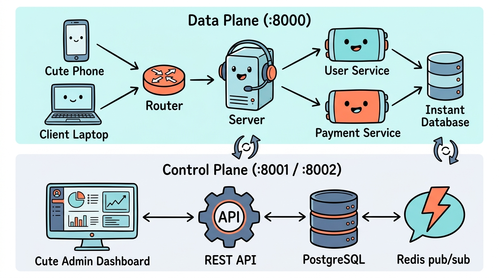
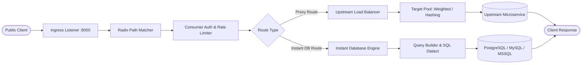
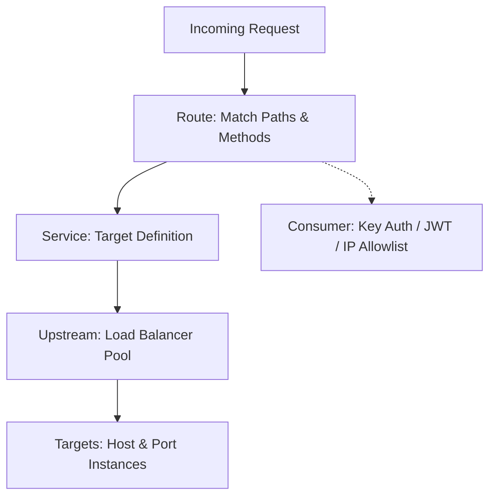

<div align="center">


# Apirout

### Cloud-Native API Router & Instant Database Engine

[](LICENSE)
[](go.mod)
[](web/)
[](docker-compose.yml)
[]()

<p align="center">
  <a href="#overview">Overview</a> •
  <a href="#system-topology">System Topology</a> •
  <a href="#request-data-flow">Request Data Flow</a> •
  <a href="#key-features">Features</a> •
  <a href="#quick-start">Quick Start</a> •
  <a href="#core-routing-entities">Core Entities</a> •
  <a href="#instant-database-apis">Instant APIs</a> •
  <a href="#deployment-modes">Deployment Modes</a> •
  <a href="#observability">Observability</a>
</p>

---

</div>

## Overview

Apirout is a high-performance, cloud-native API router and instant data proxy written in Go with an integrated React management console. It routes, load balances, secures, and monitors traffic across backend microservices with sub-millisecond dispatch overhead.

Beyond traditional reverse proxying, Apirout includes an integrated Instant Database Engine that introspects relational databases (PostgreSQL, MySQL, and SQL Server) to expose secure REST collections and parameterized SQL queries without writing bespoke backend code.

---

## System Topology

Apirout decouples runtime traffic management from administrative state, operating as a coordinated two-plane system:



### Data Plane (:8000)
A stateless, high-throughput ingress engine handling request matching, rate limiting, authentication verification, and upstream dispatch. It routes directly to microservice target pools and executes instant database queries against connected database sources.

### Control Plane (:8001 / :8002)
The administrative layer hosting the Management REST API (`:8001`) and the browser Web Console (`:8002`). Route definitions, access policies, and telemetry are stored in the PostgreSQL registry and broadcast across Data Plane nodes in real time using Redis Pub/Sub invalidation channels.

---

## Request Data Flow

Every incoming HTTP request traverses an internal pipeline before proxying to upstream services or executing against connected database engines:



---

## Key Features

- **Radix Tree Request Routing**: Sub-millisecond routing supporting exact paths, prefix matches, wildcard segments, and automatic path stripping.
- **Decoupled Plane Architecture**: Run as an all-in-one process (`ROLE=traditional`) or split into stateless edge Data Planes and private Control Planes.
- **Zero-Downtime Configuration Sync**: Route, service, and upstream mutations broadcast across all gateway nodes via Redis Pub/Sub in under 2ms without process restarts.
- **Upstream Health Checks & Load Balancing**: Target pools supporting weighted round-robin, consistent IP hashing, active background HTTP/TCP health checks, and circuit breaking.
- **Consumer Authentication & Security**: API Keys, Bearer JWT validation, CIDR IP access control lists, Host header matching, and token-bucket rate limiting per consumer or route.
- **Instant Database REST Engine**: Introspects connected database schemas to provide immediate REST endpoints supporting filtering (`eq`, `neq`, `gt`, `gte`, `lt`, `lte`, `like`, `in`), sorting (`order`), and pagination (`limit`, `offset`).
- **Parameterized SQL Workbench**: Build and execute custom SQL statements with parameter injection (e.g. `SELECT * FROM orders WHERE status = {{status}}`) and publish them as managed endpoints.
- **Server-Side Paginated Observability**: Full server-side pagination, debounced filtering, Prometheus `/metrics` exporter, and real-time P50/P90/P99 latency calculations.
- **Production Edge Proxy**: Pre-configured Nginx reverse proxy with SSL termination and real-client IP preservation for production VPS and Kubernetes.

---

## Quick Start

### 1. Prerequisites
- Docker & Docker Compose
- (Optional for building from source) Go 1.22+ and Node.js 20+

### 2. Launch with Docker Compose

Clone the repository and launch the full stack:

```bash
git clone https://github.com/apirout/apirout.git
cd apirout

# Launch PostgreSQL 16, Redis 7, and Apirout
docker compose up -d --build
```

### 3. Service Access Endpoints

| Port | Service | Purpose | Auth |
| :--- | :--- | :--- | :--- |
| **`:8000`** | **Data Plane Proxy** | Ingress traffic and published API endpoints | Route / Consumer rules |
| **`:8001`** | **Control Plane Admin API** | REST API for gateway configuration | Admin Secret / JWT |
| **`:8002`** | **Admin Web Console** | Single-page application management portal | Web User Login |
| **`:8100`** | **Status & Metrics** | Prometheus `/metrics` and health endpoints | Internal / Open |

Default Web Console credentials:
- **URL**: [http://localhost:8002](http://localhost:8002)
- **Email**: `admin@apirout.io`
- **Password**: `AdminApirout2026!`

### 4. Production Deployment

For production deployments outside local development, Apirout provides standardized deployment topologies in [`deploy/`](deploy/):
- **Production VPS (Docker Compose + Nginx Edge Proxy)**: Runs an edge Nginx reverse proxy on ports **80** and **443** with SSL/TLS termination and real client IP preservation (`deploy/docker-compose.prod.yml`).
- **Production Kubernetes Cluster**: Autonomous Control-Plane (2 replicas) and Data-Plane (3 replicas with HPA) deployments with zero-trust NetworkPolicies (`deploy/k8s/`).

See the complete [Deployment Guide](deploy/README.md) for detailed setup instructions.

---

## Core Routing Entities

Apirout organizes routing around five foundational entities:



### 1. Service (`/api/v1/services`)
Represents an upstream backend API or microservice:
```bash
curl -i -X POST http://localhost:8001/api/v1/services \
  -H "Authorization: Bearer <ADMIN_TOKEN>" \
  -H "Content-Type: application/json" \
  -d '{
    "name": "users-service",
    "url": "http://user-api.internal:8080/v1",
    "retries": 3,
    "connect_timeout": 5000,
    "read_timeout": 10000
  }'
```

### 2. Route (`/api/v1/routes`)
Defines matching rules to forward requests to a Service:
```bash
curl -i -X POST http://localhost:8001/api/v1/routes \
  -H "Authorization: Bearer <ADMIN_TOKEN>" \
  -H "Content-Type: application/json" \
  -d '{
    "name": "users-route",
    "service_id": "<SERVICE_ID>",
    "paths": ["/api/v1/users"],
    "methods": ["GET", "POST"],
    "strip_path": true,
    "auth_required": true
  }'
```

### 3. Upstream & Targets (`/api/v1/upstreams`)
Virtual host load balancer pool distributing traffic across target servers:
```bash
# 1. Create an Upstream pool
curl -i -X POST http://localhost:8001/api/v1/upstreams \
  -H "Authorization: Bearer <ADMIN_TOKEN>" \
  -H "Content-Type: application/json" \
  -d '{
    "name": "payment-upstream",
    "algorithm": "round-robin",
    "health_check_path": "/health"
  }'

# 2. Add Target instances
curl -i -X POST http://localhost:8001/api/v1/upstreams/<UPSTREAM_ID>/targets \
  -H "Authorization: Bearer <ADMIN_TOKEN>" \
  -H "Content-Type: application/json" \
  -d '{
    "target": "10.0.1.15:8080",
    "weight": 100
  }'
```

### 4. Consumer (`/api/v1/consumers`)
Represents an authenticated client application or partner consuming your APIs:
```bash
# 1. Register a Consumer
curl -i -X POST http://localhost:8001/api/v1/consumers \
  -H "Authorization: Bearer <ADMIN_TOKEN>" \
  -H "Content-Type: application/json" \
  -d '{
    "username": "mobile-app-client",
    "custom_id": "client-9901"
  }'

# 2. Provision an API Key
curl -i -X POST http://localhost:8001/api/v1/consumers/<CONSUMER_ID>/key-auth \
  -H "Authorization: Bearer <ADMIN_TOKEN>"
```

---

## Instant Database APIs

Connect a PostgreSQL, MySQL, or SQL Server database in the Web Console to instantly expose table collections as REST endpoints:

```http
GET /api/v1/instant/:connection_id/customers?status=eq.active&order=created_at.desc&limit=20
```

### Query Filter Operators

| Operator | Syntax Example | Meaning |
| :--- | :--- | :--- |
| `eq` | `?role=eq.admin` | Equals |
| `neq` | `?status=neq.deleted` | Not equals |
| `gt`, `gte` | `?price=gte.100` | Greater than / or equal |
| `lt`, `lte` | `?age=lt.30` | Less than / or equal |
| `like` | `?email=like.%40gmail.com` | Pattern matching |
| `in` | `?id=in.(1,2,5,10)` | Value in list |
| `order` | `?order=created_at.desc` | Sorting direction |
| `limit` / `offset` | `?limit=50&offset=100` | Pagination window |

---

## Deployment Modes

Apirout supports 3 deployment roles via the `ROLE` environment variable:

```bash
# 1. Traditional Mode (Default)
# Runs Proxy (:8000), Admin API (:8001), and Web GUI (:8002) in a single binary.
ROLE=traditional ./apirout

# 2. Control Plane Mode
# Runs Admin API (:8001) and Web GUI (:8002) only. Suitable for isolated management VPCs.
ROLE=control_plane ./apirout

# 3. Data Plane Mode
# Runs stateless Proxy (:8000) only. Optimized for edge nodes and Kubernetes pods.
ROLE=data_plane ./apirout
```

---

## Observability & Metrics

Apirout provides built-in runtime telemetry and audit logging:

- **Prometheus Metrics**: Available on `http://localhost:8100/metrics`.
  - `apirout_http_requests_total{status, method, route}`
  - `apirout_http_request_duration_seconds{route}`
  - `apirout_upstream_health_status{upstream, target}`
- **Server-Side Paginated API Logs**: Inspect historical gateway traffic on `/logs` with server-side SQL pagination, page-size selection (`10`, `25`, `50`, `100`), debounced searching, and method/status filtering.
- **Administrative Audit Trail**: Comprehensive audit logs on `/settings/activity-logs` tracking logins, configuration mutations, and system events.
- **Real-Time Percentiles**: Dynamic P50, P90, and P99 response time distribution calculation displayed in the Web Console dashboard.

---

## Configuration Reference

| Variable | Default | Description |
| :--- | :--- | :--- |
| `ROLE` | `traditional` | Runtime role: `traditional`, `control_plane`, `data_plane` |
| `PROXY_PORT` | `8000` | Port for incoming public API traffic (Data Plane) |
| `ADMIN_PORT` | `8001` | Port for Control Plane Management REST API |
| `GUI_PORT` | `8002` | Port for Web Console Single Page Application |
| `STATUS_PORT` | `8100` | Port for health checks and Prometheus metrics |
| `ADMIN_SECRET` | `MasterSecretKey2026!` | Master administrative API key |
| `JWT_SECRET` | `super-secret-jwt-key...` | Cryptographic secret for signing tokens |
| `DB_TYPE` | `postgres` | Registry database engine: `postgres`, `sqlite` |
| `DB_HOST` | `postgres` | Registry database hostname |
| `DB_PORT` | `5432` | Registry database port |
| `REDIS_HOST` | `redis` | Redis server for distributed cache invalidation |
| `REDIS_PORT` | `6379` | Redis server port |

---

## Documentation & Guides

- [Architecture Blueprint](docs/ARCHITECTURE.md) — Technical architecture specification
- [5-Minute Quickstart Guide](docs/QUICKSTART.md) — Tutorial from zero to running API
- [Production Best Practices](docs/BEST_PRACTICES.md) — Hardening, security, and performance tuning
- [Multiplane Deployment Plan](docs/PLAN_PEMISAHAN_MULTIPLANES.md) — Control Plane & Data Plane deployment guide

---

## License

Apirout is open-source software licensed under the [Apache License, Version 2.0](LICENSE).
