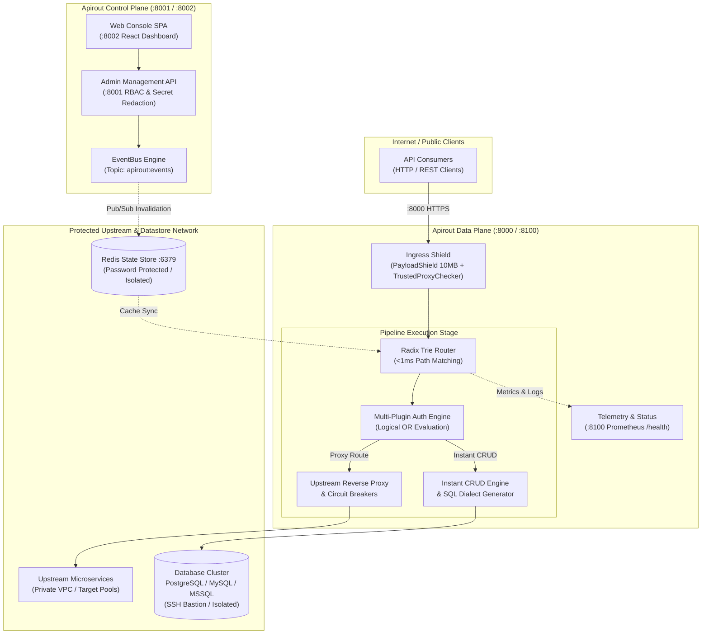
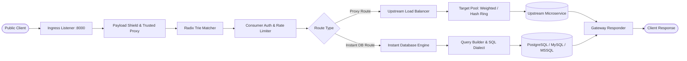
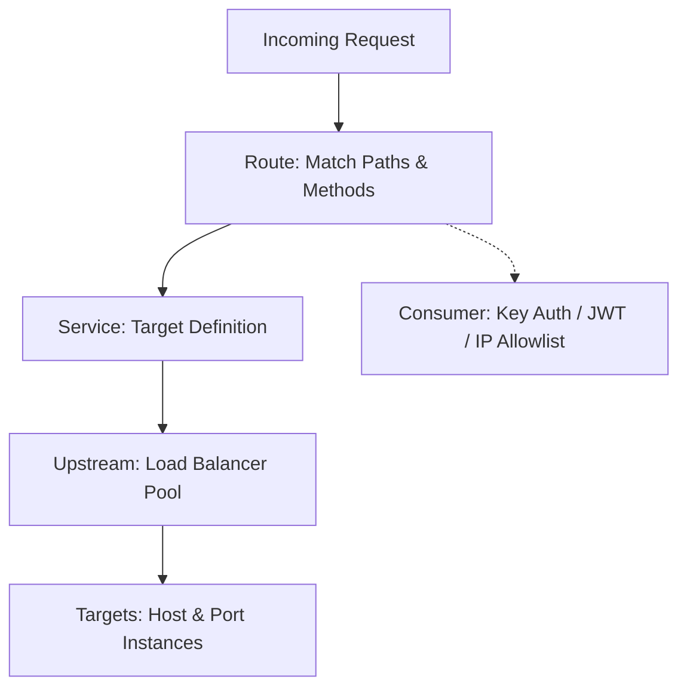

<div align="center">


# Apirout

### Cloud-Native API Router & Instant Database Engine

[](LICENSE)
[](go.mod)
[](web/)
[](docker-compose.yml)
[](docs/architecture-runtime.html)
[](#security--zero-trust-architecture)

<p align="center">
  <a href="#overview">Overview</a> •
  <a href="#architecture--system-topology">Architecture</a> •
  <a href="#interactive-architecture-showcase">Interactive Showcase</a> •
  <a href="#security--zero-trust-architecture">Security</a> •
  <a href="#request-data-flow">Request Data Flow</a> •
  <a href="#key-features">Features</a> •
  <a href="#quick-start">Quick Start</a> •
  <a href="#core-routing-entities">Core Entities</a> •
  <a href="#instant-database-apis">Instant APIs</a> •
  <a href="#deployment-modes">Deployment Modes</a> •
  <a href="#observability--metrics">Observability</a>
</p>

---

</div>

## Overview

Apirout is a high-performance, cloud-native API router, instant data proxy, and API management platform written in Go with an integrated React Web Console. It routes, load balances, secures, and monitors traffic across backend microservices with sub-millisecond dispatch overhead.

Beyond traditional reverse proxying, Apirout includes an integrated **Instant Database Engine** that introspects relational databases (PostgreSQL, MySQL, and Microsoft SQL Server) to expose secure REST collections and parameterized SQL queries without writing bespoke backend code.

Apirout operates as a decoupled two-plane architecture with an enterprise-grade Zero-Trust security model, featuring centralized SSRF protection, authenticated AEAD credential storage, cryptographic plane separation, and distributed Redis Pub/Sub synchronization.

---

## Architecture & System Topology

Apirout decouples runtime traffic management from administrative state across four formal architectural boundaries verified by [Archify](docs/architecture-runtime.html):



### The Four Architectural Boundaries

1. **Apirout Control Plane (`:8001` / `:8002`)**:
   - Hosts the administrative REST API (`:8001`) and the Web Console (`:8002`).
   - Enforces strict Role-Based Access Control (`SUPER_ADMIN`, `ADMIN`, `OPERATOR`, `VIEWER`).
   - Automatically redacts sensitive passwords and API keys in management responses.
   - Publishes configuration mutations in real-time across the cluster via Redis Pub/Sub (`Topic: apirout:events`).

2. **Apirout Data Plane (`:8000` / `:8100`)**:
   - High-throughput, stateless traffic proxy listening on port `:8000`.
   - Protected at the edge by `PayloadShield` (10MB body cap with RFC 413 envelopes) and `TrustedProxyChecker` (CIDR-verified client IP resolution).
   - Dedicated telemetry port (`:8100`) exposing Prometheus `/metrics` and Kubernetes `/health` probes.

3. **Pipeline Execution Stage**:
   - In-memory Radix Trie router resolving routes in `<1ms` with zero allocations.
   - Multi-plugin authentication evaluating heterogeneous schemes (`key-auth`, `jwt-auth`, `basic-auth`, `oauth2`, `hmac-auth`) using Logical OR semantics.
   - Upstream reverse proxy with passive circuit breaking and outbound credential injection (Bearer, Basic, API Key, AWS SigV4, OAuth2 Client Credentials).
   - Instant CRUD SQL dialect engine generating optimized parameterized queries.

4. **Protected Upstream & Datastore Network**:
   - Upstream microservice target pools with active/passive health checks and weighted load balancing.
   - External database clusters (PostgreSQL, MySQL, SQL Server) secured via loopback isolation or SSH Bastion jump-host tunnels.
   - Distributed Redis node with mandatory authentication (`--requirepass`).

---

## Interactive Architecture Showcase

Apirout includes a self-contained, interactive architecture review artifact generated by **Archify**. It provides visual exploration of components, data flow lines, security boundaries, and code source traceability.

👉 **[Open Interactive Architecture Showcase (HTML)](docs/architecture-runtime.html)**

### Key Architecture Pillars

| Pillar | Focus | Core Capabilities |
| :--- | :--- | :--- |
| 🛡️ **Ingress & Edge Shielding** | Boundary Protection | 10MB payload enforcement, CIDR trusted proxy verification, sub-millisecond Radix Trie matching. |
| 🔐 **Pipeline & Inbound Auth** | Access Control | Multi-plugin evaluation with Logical OR fallback, route/consumer token-bucket rate limiting. |
| ⚡ **Upstream & Instant CRUD** | Resilient Proxying | Passive circuit breaking, outbound SigV4 / OAuth2 CC injection, multi-engine SQL dialect generation, SSH tunneling. |
| 🔄 **Control Plane Sync** | Zero-Downtime State | Port separation, automatic secret redaction, atomic pointer swapping via Redis Pub/Sub events. |
| 📊 **Observability & Telemetry** | Operations & Audit | Dedicated `:8100` metrics/health port, `X-Request-ID` correlation tracing, structured JSON access logging. |

---

## Security & Zero-Trust Architecture

Apirout implements comprehensive, defense-in-depth security hardening across all layers (formalized in [ADR-0012](docs/adr/0012-runtime-architecture-boundaries-and-security-seams.md)):

```
┌────────────────────────────────────────────────────────────────────────┐
│                        ZERO-TRUST SECURITY MODEL                       │
├────────────────────────────────┬───────────────────────────────────────┤
│ 🌐 Centralized Egress SSRF     │ Blocks loopback (127.0.0.0/8), cloud  │
│    Shield                      │ metadata (169.254.169.254), and RFC   │
│                                │ 1918 private subnets on all outbound  │
│                                │ connections & OAuth2 token exchanges. │
├────────────────────────────────┼───────────────────────────────────────┤
│ 🔒 Authenticated AEAD at Rest  │ AES-256-GCM with 96-bit nonces (gcm:  │
│    (AES-256-GCM)               │ tag). Detects ciphertext tampering on │
│                                │ database passwords and inbound auth   │
│                                │ plugin configurations. Auto-redaction │
│                                │ on management read APIs.              │
├────────────────────────────────┼───────────────────────────────────────┤
│ 🔑 Cryptographic Plane         │ Decoupled CONSOLE_JWT_SECRET (Control │
│    Separation                  │ Plane) and GATEWAY_JWT_SECRET (Data   │
│                                │ Plane). Explicit rejection of admin   │
│                                │ claims (typ: admin) on gateway routes.│
├────────────────────────────────┼───────────────────────────────────────┤
│ 🛡️ SQL Query Evasion Defense   │ Strict query validation rejecting file│
│                                │ writes (INTO OUTFILE), file reads     │
│                                │ (LOAD_FILE), and time-delay DoS       │
│                                │ primitives (SLEEP, BENCHMARK, WAITFOR)│
├────────────────────────────────┼───────────────────────────────────────┤
│ 🚦 Trusted Proxy Ingress       │ Eliminates X-Forwarded-For spoofing by│
│                                │ verifying client IP against configured│
│                                │ TRUSTED_PROXIES CIDR masks.           │
├────────────────────────────────┼───────────────────────────────────────┤
│ 🏰 Infrastructure Isolation    │ Loopback bindings (127.0.0.1) for DBs │
│                                │ and mandatory REDIS_PASSWORD auth.    │
│                                │ URL-encoded credential DSN parsing.   │
└────────────────────────────────┴───────────────────────────────────────┘
```

---

## Request Data Flow

Every incoming HTTP request traverses an ordered pipeline before forwarding to upstream services or executing database queries:



---

## Key Features

- **Sub-Millisecond Radix Tree Routing**: High-throughput routing supporting exact paths, prefix matches, wildcard segments, and automatic path stripping.
- **Decoupled Plane Architecture**: Run as an all-in-one binary (`ROLE=traditional`) or decouple into stateless edge Data Planes and isolated Control Planes.
- **Zero-Downtime Configuration Sync**: Route, service, and upstream mutations broadcast across all gateway nodes via Redis Pub/Sub in under 2ms without process restarts.
- **Centralized SSRF Egress Shield**: Strict destination IP validation blocking internal loopback, link-local metadata, and unauthorized private CIDRs.
- **Upstream Health Checks & Load Balancing**: Target pools supporting weighted round-robin, consistent IP hash rings, active HTTP/TCP health checks, and passive circuit breaking.
- **Consumer Authentication & Security**: API Keys, Bearer JWT validation, Basic Auth, HMAC signatures, CIDR IP access control lists, Host header matching, and token-bucket rate limiting per consumer or route.
- **Instant Database REST Engine**: Introspects connected PostgreSQL, MySQL, and Microsoft SQL Server databases to provide immediate REST endpoints supporting filtering (`eq`, `neq`, `gt`, `gte`, `lt`, `lte`, `like`, `in`), sorting (`order`), and pagination (`limit`, `offset`).
- **Parameterized SQL Workbench**: Build and execute custom SQL statements with parameter injection (e.g. `SELECT * FROM orders WHERE status = {{status}}`) with AST injection protection and publish them as managed endpoints.
- **Authenticated AEAD Credential Storage**: Symmetric AES-256-GCM encryption with tamper detection for database credentials and inbound auth secrets.
- **Server-Side Paginated Observability**: Full server-side pagination, debounced filtering, Prometheus `/metrics` exporter, and real-time P50/P90/P99 latency calculations.
- **Production Edge Proxy**: Pre-configured Nginx reverse proxy with SSL termination and real-client IP preservation for production VPS and Kubernetes.

---

## Quick Start

### 1. Prerequisites
- Docker & Docker Compose
- (Optional for building from source) Go 1.22+ and Node.js 20+

### 2. Launch with Docker Compose

Clone the repository and launch the full stack:

```bash
git clone https://github.com/apirout/apirout.git
cd apirout

# Launch PostgreSQL 16, Redis 7, and Apirout
docker compose up -d --build
```

### 3. Service Access Endpoints

| Port | Service | Purpose | Auth |
| :--- | :--- | :--- | :--- |
| **`:8000`** | **Data Plane Proxy** | Ingress traffic and published API endpoints | Route / Consumer rules |
| **`:8001`** | **Control Plane Admin API** | REST API for gateway configuration | Admin Secret / JWT |
| **`:8002`** | **Admin Web Console** | Single-page application management portal | Web User Login |
| **`:8100`** | **Status & Metrics** | Prometheus `/metrics` and health endpoints | Internal / Open |

Default Web Console credentials:
- **URL**: [http://localhost:8002](http://localhost:8002)
- **Email**: `admin@apirout.io`
- **Password**: `AdminApirout2026!`

### 4. Production Deployment

For production deployments outside local development, Apirout provides standardized deployment topologies in [`deploy/`](deploy/):
- **Production VPS (Docker Compose + Nginx Edge Proxy)**: Runs an edge Nginx reverse proxy on ports **80** and **443** with SSL/TLS termination and real client IP preservation (`deploy/docker-compose.prod.yml`).
- **Production Kubernetes Cluster**: Autonomous Control-Plane (2 replicas) and Data-Plane (3 replicas with HPA) deployments with zero-trust NetworkPolicies (`deploy/k8s/`).

See the complete [Deployment Guide](deploy/README.md) for detailed setup instructions.

---

## Core Routing Entities

Apirout organizes routing around five foundational entities:



### 1. Service (`/api/v1/services`)
Represents an upstream backend API or microservice:
```bash
curl -i -X POST http://localhost:8001/api/v1/services \
  -H "Authorization: Bearer <ADMIN_TOKEN>" \
  -H "Content-Type: application/json" \
  -d '{
    "name": "users-service",
    "url": "http://user-api.internal:8080/v1",
    "retries": 3,
    "connect_timeout": 5000,
    "read_timeout": 10000
  }'
```

### 2. Route (`/api/v1/routes`)
Defines matching rules to forward requests to a Service:
```bash
curl -i -X POST http://localhost:8001/api/v1/routes \
  -H "Authorization: Bearer <ADMIN_TOKEN>" \
  -H "Content-Type: application/json" \
  -d '{
    "name": "users-route",
    "service_id": "<SERVICE_ID>",
    "paths": ["/api/v1/users"],
    "methods": ["GET", "POST"],
    "strip_path": true,
    "auth_required": true
  }'
```

### 3. Upstream & Targets (`/api/v1/upstreams`)
Virtual host load balancer pool distributing traffic across target servers:
```bash
# 1. Create an Upstream pool
curl -i -X POST http://localhost:8001/api/v1/upstreams \
  -H "Authorization: Bearer <ADMIN_TOKEN>" \
  -H "Content-Type: application/json" \
  -d '{
    "name": "payment-upstream",
    "algorithm": "round-robin",
    "health_check_path": "/health"
  }'

# 2. Add Target instances
curl -i -X POST http://localhost:8001/api/v1/upstreams/<UPSTREAM_ID>/targets \
  -H "Authorization: Bearer <ADMIN_TOKEN>" \
  -H "Content-Type: application/json" \
  -d '{
    "target": "10.0.1.15:8080",
    "weight": 100
  }'
```

### 4. Consumer (`/api/v1/consumers`)
Represents an authenticated client application or partner consuming your APIs:
```bash
# 1. Register a Consumer
curl -i -X POST http://localhost:8001/api/v1/consumers \
  -H "Authorization: Bearer <ADMIN_TOKEN>" \
  -H "Content-Type: application/json" \
  -d '{
    "username": "mobile-app-client",
    "custom_id": "client-9901"
  }'

# 2. Provision an API Key
curl -i -X POST http://localhost:8001/api/v1/consumers/<CONSUMER_ID>/key-auth \
  -H "Authorization: Bearer <ADMIN_TOKEN>"
```

---

## Instant Database APIs

Connect a PostgreSQL, MySQL, or Microsoft SQL Server database in the Web Console to instantly expose table collections as REST endpoints:

```http
GET /api/v1/instant/:connection_id/customers?status=eq.active&order=created_at.desc&limit=20
```

### Query Filter Operators

| Operator | Syntax Example | Meaning |
| :--- | :--- | :--- |
| `eq` | `?role=eq.admin` | Equals |
| `neq` | `?status=neq.deleted` | Not equals |
| `gt`, `gte` | `?price=gte.100` | Greater than / or equal |
| `lt`, `lte` | `?age=lt.30` | Less than / or equal |
| `like` | `?email=like.%40gmail.com` | Pattern matching |
| `in` | `?id=in.(1,2,5,10)` | Value in list |
| `order` | `?order=created_at.desc` | Sorting direction |
| `limit` / `offset` | `?limit=50&offset=100` | Pagination window |

---

## Deployment Modes

Apirout supports 3 deployment roles via the `ROLE` environment variable:

```bash
# 1. Traditional Mode (Default)
# Runs Proxy (:8000), Admin API (:8001), and Web GUI (:8002) in a single binary.
ROLE=traditional ./apirout

# 2. Control Plane Mode
# Runs Admin API (:8001) and Web GUI (:8002) only. Suitable for isolated management VPCs.
ROLE=control_plane ./apirout

# 3. Data Plane Mode
# Runs stateless Proxy (:8000) only. Optimized for edge nodes and Kubernetes pods.
ROLE=data_plane ./apirout
```

---

## Observability & Metrics

Apirout provides built-in runtime telemetry and audit logging:

- **Prometheus Metrics**: Available on `http://localhost:8100/metrics`.
  - `apirout_http_requests_total{status, method, route}`
  - `apirout_http_request_duration_seconds{route}`
  - `apirout_upstream_health_status{upstream, target}`
- **Server-Side Paginated API Logs**: Inspect historical gateway traffic on `/logs` with server-side SQL pagination, page-size selection (`10`, `25`, `50`, `100`), debounced searching, and method/status filtering.
- **Administrative Audit Trail**: Comprehensive audit logs on `/settings/activity-logs` tracking logins, configuration mutations, and system events.
- **Real-Time Percentiles**: Dynamic P50, P90, and P99 response time distribution calculation displayed in the Web Console dashboard.

---

## Configuration Reference

| Variable | Default | Description |
| :--- | :--- | :--- |
| `ROLE` | `traditional` | Runtime role: `traditional`, `control_plane`, `data_plane` |
| `PROXY_PORT` | `8000` | Port for incoming public API traffic (Data Plane) |
| `ADMIN_PORT` | `8001` | Port for Control Plane Management REST API |
| `GUI_PORT` | `8002` | Port for Web Console Single Page Application |
| `STATUS_PORT` | `8100` | Port for health checks and Prometheus metrics |
| `ADMIN_SECRET` | `MasterSecretKey2026!` | Master administrative API key bypass (min 24 chars in production) |
| `JWT_SECRET` | `super-secret-jwt-key...` | Cryptographic secret for signing tokens (legacy fallback, min 32 chars) |
| `CONSOLE_JWT_SECRET` | *(falls back to JWT_SECRET)* | Dedicated signing secret for Control Plane admin users |
| `GATEWAY_JWT_SECRET` | *(falls back to JWT_SECRET)* | Dedicated signing secret for Data Plane consumer tokens |
| `APP_ENCRYPTION_KEY` | `apirout-local-dev-aes...` | AES-256 key for upstream credential encryption (min 32 chars) |
| `TRUSTED_PROXIES` | `""` | Comma-separated trusted proxy CIDRs (e.g. `10.0.0.0/8,172.16.0.0/12`) |
| `DB_TYPE` | `postgres` | Registry database engine: `postgres`, `sqlite` |
| `DB_HOST` | `postgres` | Registry database hostname |
| `DB_PORT` | `5432` | Registry database port |
| `DB_PASSWORD` | `Password123!` | Registry database password |
| `REDIS_HOST` | `redis` | Redis server for distributed cache invalidation |
| `REDIS_PORT` | `6379` | Redis server port |
| `REDIS_PASSWORD` | `RedisSecurePass2026!` | Mandatory Redis authentication password |

---

## Documentation & Architecture Records

- **[Interactive Architecture Showcase](docs/architecture-runtime.html)** — Self-contained interactive visualization with component filtering and layer inspection
- **[Architecture Blueprint](docs/ARCHITECTURE.md)** — Comprehensive technical architecture specification
- **[ADR Index](docs/adr/)** — Architecture Decision Records:
  - [ADR-0012: Runtime Architecture Boundaries & Full-Stack Security Seams](docs/adr/0012-runtime-architecture-boundaries-and-security-seams.md)
  - [ADR-0010: Deep Architecture and Authentic Credential Seams](docs/adr/0010-deep-architecture-and-authentic-credential-seams.md)
  - [ADR-0009: Trusted Proxy Ingress and Security Shield Architecture](docs/adr/0009-trusted-proxy-ingress-and-security-shield-architecture.md)
  - [ADR-0008: Form Event Isolation and Multi-Plugin OR Semantics](docs/adr/0008-form-event-isolation-and-multi-plugin-or-semantics.md)
- **[5-Minute Quickstart Guide](docs/QUICKSTART.md)** — Tutorial from zero to running API
- **[Production Best Practices](docs/BEST_PRACTICES.md)** — Hardening, security, and performance tuning
- **[Branching & Release Guide](docs/BRANCHING_AND_RELEASING.md)** — Trunk-based development and release workflow

---

## License

Apirout is open-source software licensed under the [Apache License, Version 2.0](LICENSE).
